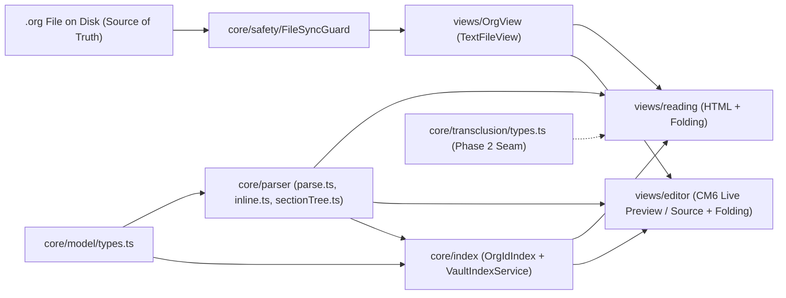

# System Architecture (`ARCHITECTURE.md`)

**Design Priority**: `Data Integrity > Reading Experience > Org Compatibility > Editing Convenience > Advanced Features`

**Core Principle**: *Org as Source of Truth, Obsidian as Reading & Interaction Layer.*  
The plugin never creates parallel Markdown copies and never strips unknown Org syntax.

## 1. High-Level Module Map

### Directory Layout

- `src/core/model/types.ts`  
  Unified AST/structural document model (`OrgDoc`, `OrgLine`, `OrgSectionNode`, `OrgSectionTree`, `OrgNodeEntry`, `OrgIdLink`, `OrgIndexDiagnostics`, `OrgViewMode`). Every structural element records exact character offsets (`from`, `to`) and line indices into the original `.org` buffer.
- `src/core/parser/`  
  **Single Source of Parsing** (zero Obsidian runtime dependency where possible):
  - `todoKeywords.ts`: Built-in, settings-based, and `#+TODO:`/`#+SEQ_TODO:`/`#+TYP_TODO:` keyword resolution (including `TODO(t)` fast-access specs and CJK keywords).
  - `parse.ts`: Line-oriented structural parser for headings, planning lines, property/generic drawers, lists/checkboxes, tables (`<l>/<c>/<r>`), blocks, math blocks, keywords (`#+TITLE:`, `#+STARTUP:`, unknown directives), comments, fixed-width lines, and horizontal rules. Handles both `\n` and `\r\n` accurately.
  - `inline.ts`: Inline token scanner (`*bold*`, `/italic/`, `_underline_`, `+strike+`, `=verbatim=`, `~code~`, `[[links]]`, URLs, math, timestamps, cookies, footnotes, tags) with CJK punctuation boundaries.
  - `inlineRender.ts`: Pure HTML escape + inline token serializer with safe URL scheme checks and Org ID status annotation.
  - `sectionTree.ts`: Converts flat `OrgDoc.lines` into a nested `OrgSectionTree` capturing hierarchy, subtree line bounds, immediate `:PROPERTIES:` (`:ID:`, `:CUSTOM_ID:`), and stable heading slugs.
- `src/core/index/`
  - `orgIdIndex.ts`: Pure incremental `OrgIdIndex` mapping `:ID:` and `:CUSTOM_ID:` to `{ filePath, line, level, title }`, extracting `[[id:...]]` links outside verbatim/code/math blocks, and producing duplicate-ID and broken-link diagnostics.
  - `vaultIndexService.ts`: Connects `OrgIdIndex` to Obsidian `Vault` events (`create`, `modify`, `rename`, `delete`) and provides cross-file node navigation + diagnostics modal.
- `src/core/safety/`
  - `fileSyncGuard.ts`: Pure state machine protecting against silent overwrites when Emacs modifies an `.org` file externally while Obsidian has unsaved edits, eliminating unnecessary saves on read-only close, and ignoring save echoes.
- `src/core/transclusion/`
  - `types.ts`: Reserved TypeScript interfaces (`TransclusionDirective`, `TransclusionResolver`) for Phase 2 read-only `#+transclude:` expansion without impacting Sprint 01 runtime.
- `src/views/`
  - `OrgView.ts`: `TextFileView` controller managing `reading` / `live` / `source` modes, CM6 instance lifecycle, conflict resolution banner, and fold-aware jump-to-line navigation.
  - `reading/render.ts` & `reading/folding.ts`: Semantic HTML reading view with nested `<section>` folding, `overview`/`content`/`all` commands, `#+STARTUP:` support, collapsed-by-default Property Drawers with raw inspection, Prism hydration, and MathJax rendering.
  - `editor/orgEditor.ts`, `editor/livePreview.ts`, `editor/fold.ts`, `editor/foldIndicator.ts`, `editor/highlight.ts`: CM6 editor shell, cursor-sensitive Live Preview (`StateField` decorations + widgets), Source mode (decorations disabled, folding/keys active), heading/block/drawer folding, and `Tab`/`Shift-Tab` keybindings.
- `src/integration/outline.ts`  
  Guarded, opt-out-capable bridge injecting Org headings into Obsidian's core Outline view.
- `src/util/`
  - `dom.ts`: Safe DOM element creation & HTML sanitization (using Obsidian's `sanitizeHTMLToDom` in runtime, safe fallback in Node/DOM tests).
  - `links.ts`: URL scheme sanitization and link routing (`id:`, `#custom-id`, `*heading`, `file:`, external URLs).
- `tests/`  
  Vitest + `happy-dom` unit, DOM, CM6 folding, Org ID index, and data-safety regression suite.

## 2. Single-Parser Guarantee

`parseOrgDoc` + `parseInline` + `buildSectionTree` are the **only** parser pipeline in the codebase:
- Reading View renders directly from `parseOrgDoc` + `buildSectionTree`.
- Live Preview caches `parseOrgDoc` per immutable CM6 `Text` instance (`WeakMap<Text, ...>`).
- CM6 folding reuses the same cached `OrgDoc`.
- `OrgIdIndex` calls `parseOrgDoc` + `buildSectionTree` + `parseInline`.

## 3. Security & Non-Execution Policy

- Zero Org Babel execution, zero `eval`, zero arbitrary script tags.
- All user text is HTML-escaped via `escapeHtml` and inserted through `sanitizeHTMLToDom`.
- Link targets are validated to reject `javascript:`, `vbscript:`, and `data:` schemes.
- Unknown Org syntax (`#+TRANSCLUDE:`, `#+CALL:`, custom blocks, custom properties) is rendered safely as inert text/cards and preserved verbatim in the buffer.

## 4. Private Obsidian API Register

1. `OutlineView.getHeadings` / `update` / `cachedHeadingDom` (`src/integration/outline.ts`) — guarded, toggleable via `enableOutlineBridge`, restored on `onunload()`.
2. `app.commands.commands` (`src/main.ts`) — best-effort runtime command label localization on language switch; wrapped in optional checks.
3. `app.internalPlugins.getPluginById("global-search")` (`src/util/links.ts`) — optional tag-search convenience; wrapped in `try/catch`.

## 5. Phase 2 / Phase 3 Extension Seams

- **Phase 2 (`core/index` + `core/transclusion`)**: `OrgIdIndex` already tracks incoming `OrgIdLink[]` (`getBacklinks(id)`), custom IDs, and all nodes (`getAllNodes()`), enabling backlinks panel, node switcher, hover preview, and read-only `#+transclude:` resolution (`TransclusionResolver`).
- **Phase 3 (Deferred)**: Callout / color card styling in `views/reading`, Notion publisher, advanced node composer UI — cleanly decoupled from `core/parser` and `.org` source files.
