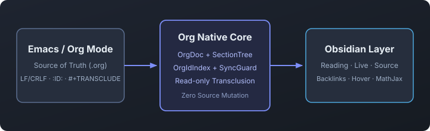

#+TITLE: Math, Code & Aligned Tables · 公式、代码与表格
#+AUTHOR: Org Native Team

* LaTeX 数学公式测试 :math:
行内公式：$E = mc^2$ 与 \(\beta_t = \text{clip}(\alpha_t, 0, 1)\)。普通价格如 $5 and $12 不会被误判为公式。

块级多行公式：

\begin{align}
\mathcal{L}(\theta) &= \mathbb{E}_{\tau \sim \mathcal{D}} \left[ \| \pi_\theta(o_t, m_t) - a_t \|_2^2 \right] \\
m_{t+1} &= \operatorname{Update}(m_t, o_t, z_t)
\end{align}

\[
\operatorname{sim}(q, k) = \frac{q^\top k}{\|q\|_2 \|k\|_2}
\]

* 代码块与伪节点免疫测试 :code:
下面的代码块内故意包含类似 Org 标题与 =:ID:= 抽屉的示例文本，索引器必须忽略它们：

#+BEGIN_SRC org
* Fake Heading Inside Code Block
:PROPERTIES:
:ID: fake-id-must-not-be-indexed
:END:
Fake link [[id:fake-broken-link-in-code]].
#+END_SRC

#+BEGIN_SRC python
def retrieve_memory(query: str, top_k: int = 5) -> list[str]:
    """Retrieve episodic memory traces for VLA policy conditioning."""
    return [f"trace-{i}:{query}" for i in range(top_k)]
#+END_SRC

#+BEGIN_SRC elisp
(setq org-id-link-to-org-use-id 'create-if-interactive)
#+END_SRC

* 对齐表格测试 (<l> / <c> / <r>) :table:
| 模块 / Module       | 状态 / Status | 优先级 | 说明 / Notes                        |
|---------------------+---------------+--------+-------------------------------------|
| <l>                 | <c>           | <r>    | <l>                                 |
| =core/parser=       | DONE          |      1 | 单一解析器 + CRLF 精确偏移          |
| =views/reading=     | DONE          |      1 | 嵌套折叠 + 安全 HTML 渲染           |
| =core/index=        | DONE          |      2 | 增量 =:ID:= 索引 + [[id:node-semantic-graph][跨文件节点]] |
| =core/transclusion= | Phase 2       |      3 | 已预留接口扩展点                    |

* 本地图片渲染测试 :image:
#+CAPTION: Org Native Architecture — Org as Source of Truth, Obsidian as Interaction Layer
#+ATTR_HTML: :width 640px

