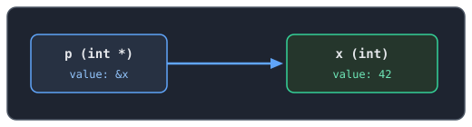

:PROPERTIES:
:ID:       90000000-0000-4000-8000-000000000001
:ROAM_ALIASES: "C Pointers & Real Notes Showcase"
:END:
#+title: 真实笔记风格综合验证 (C / Java / EE / Benchmark)
#+filetags: :C:Java:Benchmark:
- tag :: [[id:90000000-0000-4000-8000-000000000010][Makefile & C Build Automation]]
- =part_v1= :: Org 描述列表定义项，不应带任何引用竖线

#+transclude: [[id:90000000-0000-4000-8000-000000000010]] :only-contents

* GCC 编译常用参数与换行保留
** 命令格式与对齐说明
*格式：gcc <options> <source-files>*
-o<filename>  指定输出文件名
-Wall         开启常用警告信息
-Werror       把警告视为错误[fn:1]

|
| Next: 自动化构建 [[id:90000000-0000-4000-8000-000000000010][Makefile 自动化]]
v

- Notion 风格箭头自动渲染：经典教材题背诵 --> 重构变量命名，benchCAD -> No LLM Judge，等价判定 A <=> B，且保留 C 指针 q->x 与 =->= 原样。

#+ATTR_ORG: :width 85%
#+CAPTION: 指针与内存位置示意图

* C 指针、转义逗号与语法高亮
:PROPERTIES:
:ID:       90000000-0000-4000-8000-000000000002
:END:
1. 变量地址：=&x= 指向变量内存位置，编译步骤 main.c \rightarrow main.i \rightarrow main.o \\
   下一行解释：evaluates expr /once/，或者 **加粗核心结论** 也不破坏原始记法。
2. 指针与 =const= 规则：

   #+begin_src C
   const int x = 3;
   const int *p = &x;
   ,*p = 4;    // 逗号转义在阅读/实时预览/复制时自动去掉
   p = &y;     // 允许修改指向
   #+end_src

   #+RESULTS:
   : Hello
   : World

#+RESULTS: "Exit code: 0"

** 多级标题与无误判斜杠/下划线/加号
---
- 路径和类型：/usr/local/include 与 TYPE var_name; int var_name = a + a / 4 - a / 100 + a / 400;
- 工程维度：编译器/仿真器，逐扫描比较输出/状态轨迹，轮数/预算/提交指令。
- 物理与公式：电流 $I = K i_x$，比例 $\text{total} = G_{\text{safety}} \times (\text{score})$，独立箭头 \Downarrow 清晰可见。

* Java 未闭合代码块容错与表格对比
#+BEGIN_SRC java
class HelloDemo {
    public static void main(String[] args) {
        System.out.println("Unclosed block should stop at next heading");
    }
}

* Output 与特性对比
| 领域 Domain | 左侧特性       | 右侧特性     |
|-------------+----------------+--------------|
| 移动/嵌入   | 效率与便携     | 桌面/服务器  |
| 控制/安全   | 硬安全互锁     | 多周期仿真   |

********* 九级深层标题（Deep Level 9）
****** 六级标题之后仍保持清晰层次
• 支持 Unicode 圆点列表项
• 连续编号与列表内代码块不会破坏整体列表结构

* 脚注定义区域
[fn:1] -Werror 把所有编译警告升级为错误。
[fn:2] | 级别 | 含义 | 处理 |
|------+------+------|
| Warning | 警告 | 默认继续编译 |
| Error   | 错误 | 中止编译     |
